<div align="center">



<br>

[](https://github.com/Vvvancy/EditHTML/actions/workflows/ci.yml)


**[✨ 特性](#-特性)** · **[👀 预览](#-预览)** · **[🧩 组件](#-组件块)** · **[⚙️ 原理](#️-工作原理)** · **[🚀 开发](#-本地开发)** · **[🗺️ 路线图](#️-路线图)** · **[📚 文档](#-文档)**

</div>

<br>

> [!NOTE]
> **EditHTML** 是一种面向个人笔记的文档格式与编辑器：**文件本身就是网页**，双击即可在任意浏览器阅读；打开后能**直接在渲染好的页面上编辑**，同时保留 Markdown 的输入手感。
> **所有 HTML 和 Markdown 都是 EditHTML 的一部分**：任意 `.html` 直接打开就能改（只改动改过的地方），任意 `.md`（含 Obsidian 笔记库）无损导入。
> 一句话 —— **Markdown 的编辑体验 + HTML 的表现力**。

## 👀 预览

<div align="center">

<sub>设计预览：选中文字浮出工具栏 · 输入 <code>/</code> 插入组件 · 图表 / 标签页 / 提示框就地可编辑（原生编辑器在 M3 实现）</sub>
</div>

## ✨ 特性

<table>
<tr>
<td width="33%" valign="top">

### 🌐 文件即网页
`.eh.html` 是合法、自包含的 HTML5。没有编辑器、没有网络，双击照样完整阅读。

</td>
<td width="33%" valign="top">

### ✍️ 就地编辑
在渲染好的页面上所见即所得地改 —— 包括图表数据、组件配置。不用回"后台"翻源码。

</td>
<td width="33%" valign="top">

### ⌨️ Markdown 手感
`#` `-` `>` `` ` `` `**` 输入规则 + `/` 斜杠菜单；`.md` 无损导入，随时导出回去。

</td>
</tr>
<tr>
<td valign="top">

### 🧩 富组件块
图表、流程图、公式、标签页、多栏、折叠、嵌入、沙箱脚本 —— 统一的插件接口，可自定义。

</td>
<td valign="top">

### 🧬 稳定序列化
同样的内容永远保存成同样的字节；改一个字，`git diff` 只动一行。由属性测试保证幂等。

</td>
<td valign="top">

### ⚡ 快且安全
零 DOM 内核可跑在 Worker；块级哈希增量渲染。脚本在 `iframe sandbox` 中运行，陌生文件默认不执行。

</td>
</tr>
<tr>
<td valign="top">

### 🪄 任意 HTML 保真编辑
AI 生成的页面、旧网页笔记，直接打开就能改字；只按源码区间打补丁，没改的地方逐字节不变。

</td>
<td valign="top">

### 📥 Markdown / Obsidian 导入
CommonMark + GFM + Obsidian 方言（双链、callout、块引用、frontmatter），整个笔记库批量导入。

</td>
<td valign="top">

### 🧱 识别不了也能编辑
映射不到原生块的 HTML 包成 `eh-html` 块原样保留，照样就地编辑，还能一键"拆解为原生块"。

</td>
</tr>
</table>

### 和常见做法比一比

| | Markdown 笔记 | 手写 HTML 页面 | **EditHTML** |
| :-- | :-: | :-: | :-: |
| 随手编辑、即时生效 | ✅ | ❌ 回源码改 | ✅ 就地编辑 |
| 图表 / 交互组件 | ⚠️ 依赖插件私有语法 | ✅ | ✅ 内置 + 可扩展 |
| 任意浏览器直接打开 | ❌ 需要渲染器 | ✅ | ✅ |
| 纯文本友好、git diff 干净 | ✅ | ⚠️ 噪音大 | ✅ 规范序列化 |
| 换工具不丢格式 | ⚠️ 扩展语法不通用 | ✅ | ✅ 标准 HTML + 降级内容 |
| 编辑现有 HTML 文件 | ❌ | ⚠️ 只能改源码 | ✅ 保真模式，diff 最小 |

## 🧩 组件块

组件块统一形态：**JSON 是真相，降级内容是缓存** —— 有运行时就是可交互组件，没有运行时也能看到静态 HTML/SVG。

```html
<eh-chart data-eh="b3">
  <script type="application/json">{"type":"bar","data":{"x":["线性","二分"],"y":[1000000,20]}}</script>
  <!--eh:fallback--><!--eh:fallback-->
</eh-chart>
```

| | 组件 | 用途 | 数据 |
| :-: | :-- | :-- | :-- |
| 📊 | `chart` | 柱 / 折线 / 饼 / 散点图，双击直接改数据 | `{type, data, options}` |
| 🔀 | `mermaid` | 流程图、时序图 | `{source}` |
| ∑ | `math` | 块级公式（KaTeX） | `{tex}` |
| 💡 | `callout` | 提示框 info / warn / tip | `{kind, title}` + 子块 |
| 🗂️ | `tabs` | 标签页 | `{tabs:[{title}]}` + 子块 |
| ▥ | `columns` | 多栏布局 | `{ratio:[1,2]}` + 子块 |
| ▸ | `toggle` | 折叠区 | `{title, open}` + 子块 |
| 🎬 | `embed` | 嵌入网页 / 视频（沙箱） | `{url, height}` |
| 🧪 | `script` | 自定义 HTML/CSS/JS 小组件（沙箱） | `{html, css, js}` |

喜欢敲源码？还有等价的 **EHMD** 文本视图，与 `.eh.html` 双向无损转换：

````markdown
# 二分查找

时间复杂度 **O(log n)**。^b2

:::chart {#b3}
type: bar
data: { x: [线性, 二分], y: [1000000, 20] }
:::
````

## ⚙️ 工作原理

<div align="center">

</div>

<details>
<summary><b>分层架构</b>（点击展开）</summary>

```
 宿主     apps/web · obsidian-plugin · runtime（文件内嵌加载器 < 8KB）
            │  HostAdapter
 editor   选区 · 输入规则 · 斜杠菜单 · 工具栏        ← ProseMirror 适配层
 renderer Doc → DOM 增量更新（块哈希 + LIS diff）· 懒加载 · 虚拟化
 blocks   组件块注册表（schema + render + fallback + EHMD）
 core     文档模型 · 流式解析 · 规范序列化 · 事务/撤销  ← 零 DOM，Node / Worker 可跑
```

- 依赖只能自上而下：`editor → renderer → blocks → core`（ESLint 强制）
- **DOM 不是数据源**：一切修改经过 `Transaction`，每个 Op 都可逆
- 详见 [架构](docs/02-architecture.md) 与 [算法](docs/03-algorithms.md)

</details>

### 已实现的内核指标

| 指标 | 目标 | 当前 |
| :-- | :-: | :-: |
| 解析 10,000 块（1.3 MB） | < 100 ms | **≈ 90 ms** |
| 序列化 10,000 块 | < 50 ms | **≈ 18–40 ms** |
| 单次文本编辑事务（10,000 块文档） | < 16 ms | **≈ 0.8 ms** |
| `parse ∘ serialize` 往返 | 无损 + 幂等 | ✅ 随机文档 + 9 万次乱序标签模糊测试 |
| Obsidian 库 `md → .eh.html → md` | 逐字节一致 | ✅ 16 篇中 15 篇逐字节一致（另 1 篇按安全规则剔除 `onclick`） |

## 🚀 本地开发

```bash
git clone https://github.com/Vvvancy/EditHTML.git && cd EditHTML
pnpm install

pnpm test      # Vitest 单元测试 + fast-check 属性测试
pnpm lint      # 类型检查 + ESLint + Prettier
pnpm build     # tsc 项目引用 + Vite
pnpm --filter @edithtml/web dev   # Web 应用开发服务器
```

命令行 `eh`（`pnpm build` 后位于 `packages/cli/dist/bin.js`）：

```bash
eh convert note.md                 # → note.eh.html，双击即可在浏览器打开（从不覆盖源文件）
eh convert vault/ -o out/          # 整个文件夹镜像转换（跳过 .obsidian 等点目录）
eh convert note.eh.html --to md    # 导回 Markdown
eh check notes/ --strict           # 校验并以 file:line:col 报告告警
eh fmt notes/                      # 规范化 .eh.html（--check 只检查）
```

需要 Node ≥ 22.12 与 pnpm。在代码里直接使用内核：

```ts
import { parse, serialize, tr } from '@edithtml/core';

const { doc } = parse(html); // .eh.html → Doc
const { doc: next } = tr(doc).insertText('b2', 0, '✨ ').apply(); // 可逆事务
await writeFile(path, serialize(next)); // 规范形式，diff 干净
```

## 🗺️ 路线图

| 里程碑 | 内容 | 进度 |
| :-- | :-- | :-- |
| **M0** 工程脚手架 | monorepo ✅ · CI ✅ · 测试样本 ✅（ehtml · md · html · Obsidian 库，共 80+） |  |
| **M1** 核心格式 + Markdown 导入 | 模型 ✅ · 解析器 ✅ · 序列化器 ✅ · 事务 ✅ · 撤销重做 ✅ · EHMD ✅ · Markdown/Obsidian 导入器 ✅ · CLI ✅ |  |
| **M2** 保真模式 ⭐ | 任意 HTML 就地编辑：源码区间索引 · 补丁引擎 · 区域源码编辑 · 写回（**第一个可用版本**） |  |
| **M3** 原生编辑器 MVP | 增量渲染 · ProseMirror 编辑器 · 输入规则 · 斜杠菜单 · 组件 · `eh-html` 块 · 运行时 · 主题 · 粘贴 |  |
| **M4** HTML 转换 + 富组件 + 性能 | HTML → 原生块 · 图表 · 容器块 · 沙箱脚本 · 懒渲染 · 虚拟化 · 增量保存 |  |
| **M5** 笔记库 + 批量导入 | Web 应用 · `eh import` 整库导入 · 全库搜索 · 双链 · 三方合并 · 源码模式 · 导出 |  |
| **M6** 生态 | Obsidian 插件 · 自定义组件 · 模板库 |  |

每个任务都可以独立交给一个 Agent 完成，见 [路线图](docs/04-roadmap.md)。

## 📁 仓库结构

```
EditHTML/
├── packages/
│   ├── core/        文档模型 · 解析器 · 序列化器 · 事务 · 撤销 · EHMD
│   ├── renderer/    Doc → DOM 增量渲染 · 懒加载 · 虚拟化 · 主题
│   ├── editor/      就地编辑：选区 · 输入规则 · 斜杠菜单 · 工具栏
│   ├── importer/    任意 HTML 保真编辑（区间补丁）· HTML/MD → 原生块 · 批量导入
│   ├── blocks/      组件块：chart · mermaid · math · tabs · callout · embed · script
│   ├── runtime/     嵌入 .eh.html 的轻量加载器
│   └── cli/         eh convert / check / fmt
├── apps/
│   ├── web/              独立 Web 编辑器
│   └── obsidian-plugin/  Obsidian 插件（M5）
├── docs/            设计文档
└── tests/           fixtures（48 个往返样本）· e2e · bench
```

## 📚 文档

| | 文档 | 内容 |
| :-: | :-- | :-- |
| 🎯 | [00 · 愿景](docs/00-vision.md) | 动机、目标用户、设计原则、非目标 |
| 📐 | [01 · 格式规范](docs/01-format-spec.md) | `.ehtml` 文件格式（草案 v0.1）与规范序列化细则 |
| 🏛️ | [02 · 架构](docs/02-architecture.md) | 分层、数据模型、数据流、插件接口 |
| ⚡ | [03 · 算法](docs/03-algorithms.md) | 流式解析、增量渲染、虚拟化、增量保存、合并 |
| 🗺️ | [04 · 路线图](docs/04-roadmap.md) | 里程碑与可分派任务 |
| ❓ | [05 · 待决问题](docs/05-open-questions.md) | 尚未拍板的设计选择 |
| 📥 | [06 · 导入与兼容](docs/06-import.md) | 任意 HTML 保真编辑、HTML/MD 转换、批量导入 |

## 🤝 参与开发

开工前请阅读 [AGENTS.md](AGENTS.md)。每个任务一个分支 `feat/T1.2-parser`、一个 PR：

- `core` 禁止 DOM API；依赖方向不可反转
- TypeScript strict，不用 `any`；公共 API 写 TSDoc
- 解析 / 序列化 / 事务改动必须附 fast-check 属性测试
- 合并前 `pnpm lint && pnpm test && pnpm build` 全部通过

<div align="center">
<br>
<sub>用 ❤️ 和大量属性测试构建 · <a href="https://github.com/Vvvancy">@Vvvancy</a></sub>
</div>
