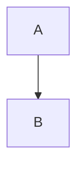

# Obsidian 风格 {#ob1}

双链 [[另一篇笔记]]、带别名 [[folder/note|别名]]、块引用 [[note#^k9x]]、标题引用 [[note#某个标题]]。 ^ob2

嵌入 ![[image.png]] 与 ![[other-note]]（嵌入语法在规范中没有对应 → 预期：保留为文本或外来块）。 ^ob3

标签 #学习 #nested/tag #2026 —— 注意 `#2026` 纯数字在 Obsidian 中不是标签。 ^ob4

高亮 ==重点==，行内公式 $a^2 + b^2 = c^2$，价格 $5 和 $10（不是公式，见 open question #7）。 ^ob5

$$
\sum_{i=1}^{n} i = \frac{n(n+1)}{2}
$$

^ob6

> [!note] Obsidian 原生 callout
> 内容在这里。预期：可映射为 eh-callout(kind=info)？（规范未定义）

> [!warning]- 可折叠 callout
> 折叠的内容。

^ob7

%% Obsidian 注释，不应出现在渲染结果中 %%

一个没有 ID 的段落，紧跟一个带 ID 的段落。

这是带 ID 的段落。 ^ob8
